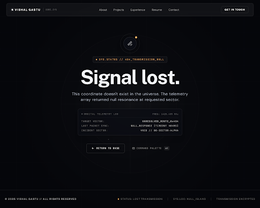

# 404_page\n\n\n\n## Prompt Used\n```\nCreate a cinematic, minimalist 404 error page for the dark sci-fi / telemetry portfolio 'Vishal Gastu'.

Atmosphere & Aesthetic:
- Full viewport height (min-h-screen or h-screen), centered vertically and horizontally. Pure deep cosmic void background (#0a0a0c or black) with very faint, nearly invisible scattered white dots / static noise / constellation coordinates at ultra-low opacity (rgba(255,255,255,0.03)).
- No cartoon illustration, no crying robots, no gimmicks. Pure typography, telemetry badges, and silence. Like losing contact with a deep-space probe. Precise, calm, on-brand.

Header / Navigation:
- Include the signature TopNavBar (or sleek minimal telemetry header): VISHAL GASTU brand mark on top left with small status indicator, and navigation links ("About", "Projects", "Experience", "Resume", "Contact") or minimal back breadcrumb.

Center Content (Strictly arranged vertically, centered):
- Top HUD badge / label: Small muted monospace font (e.g. JetBrains Mono / font-mono / font-label) in subtle glowing tag: "[ SYS.STATUS // 404_TRANSMISSION_NULL ]" or "ERROR 404 // BEACON UNRESPONSIVE" with a tiny amber or cyan pulsing dot.
- Main Headline: Massive, commanding Syne Bold / font-display tracking-tight text: "Signal lost." spanning wide across the screen in luminous white/silver.
- Subheading: DM Sans / font-body secondary text (text-neutral-400 / text-white/60) with elegant tracking: "This coordinate doesn't exist in the universe."
- Sub-telemetry snippet (optional atmospheric micro-copy): Monospace telemetry readout: "LAST KNOWN VECTOR: UNRESOLVED ROUTE :: SECTOR 00 // PACKET TIMEOUT 404MS".
- Primary Action: Ghost-outline button with subtle border border-white/20 hover:border-white/60 hover:bg-white/5 transition-all text-white px-6 py-3 rounded-lg font-mono text-sm tracking-widest uppercase flex items-center gap-2: "← Return to base" (or "Return to base"). Optionally a secondary subtle text link "Open command palette (⌘K)".

Footer:
- Matching portfolio telemetry footer: "© 2025 VISHAL GASTU // ALL RIGHTS RESERVED", status indicators "STATUS: LOST TRANSMISSION", "SYS.LOC: NULL_ISLAND", "TRANSMISSION ENCRYPTED".\n```\n