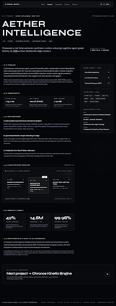

# case_study\n\n\n\n## Prompt Used\n```\nDesign an editorial, architectural case study page for a dark portfolio.
Theme & Visual Tone: Ultra-refined dark mode, editorial precision, deep pitch black and dark glass panels, subtle border borders (rgba(255,255,255,0.1) and ghost white accents rgba(255,255,255,0.2)). Typography uses Syne for display/headings and DM Sans / clean sans for editorial body copy with monospace metadata.

Structure and Content:
1. Top Navigation Bar: Minimalist portfolio header from {{DATA:COMPONENTS:COMPONENTS_3}} (Vishal Gastu, nav links, status indicator).
2. Project Header & Hero Section:
   - Monospace muted breadcrumb: "PROJECTS / AETHER INTELLIGENCE" (or "01 // PROJECTS / AETHER INTELLIGENCE [CORE-SYS]")
   - Giant, striking Syne Bold title: "Aether Intelligence" with high tracking and editorial poise.
   - Tag row below title: pill badges for "AI" · "Python" · "Autonomous Systems" · "Distributed Memory" · "2024".
   - One-sentence outcome in larger DM Sans secondary text: "Pioneered a real-time semantic synthesis runtime reducing cognitive agent graph latency by 42% across distributed edge clusters."
   - Subtle metadata bar: quick stats or client/scope note.

3. Main 2-Column Editorial Grid (max-w-7xl mx-auto px-6 py-12 grid grid-cols-1 lg:grid-cols-12 gap-12):
   - Left Column (lg:col-span-8 / ~65%):
     Detailed case study narrative with pristine vertical rhythm.
     Section styling: Section headings in Syne Medium, tracked/letter-spaced uppercase with a thin left border in ghost white rgba(255,255,255,0.20) (pl-4 border-l border-white/20 mb-4).
     - Section: "01 // Problem": Deep dive into context, distributed memory bottlenecks, and token budget exhaustion in dynamic agent swarms.
     - Section: "02 // Constraints": High-frequency telemetry limits, zero-downtime cluster synchronization, sub-15ms budget.
     - Section: "03 // Key Decisions": Structural architectural decisions (decoupled consensus engine, vector indexing at edge, lightweight custom protocol).
     - Section: "04 // Architecture": Interactive/schematic dark-mode diagram box. Features a sleek, futuristic system topology with node clusters, glowing data conduits, monospace protocol tags (SYS_GRAPH_V2, KERNEL_DISPATCH, LATENCY_PROBE), subtle constellation or grid accents like {{DATA:IMAGE:IMAGE_4}}.
     - Section: "05 // Results & Impact":
       Row of 3 metric cards (Dark glass, subtle border rgba(255,255,255,0.1), backdrop-blur-md, p-6):
       * Card 1: "42%" in large Syne Bold, muted label "LATENCY REDUCTION"
       * Card 2: "14.8M" in large Syne Bold, muted label "VECTOR EMBEDDINGS / SEC"
       * Card 3: "99.98%" in large Syne Bold, muted label "CONSENSUS FIDELITY"
     - Section: "06 // Retrospective & What I'd Do Differently": Thoughtful reflections on rust vs python FFI bindings and warm cache strategies.

   - Right Column (lg:col-span-4 / ~35%):
     Sticky sidebar card (sticky top-28 bg-white/[0.03] backdrop-blur-xl border border-white/10 rounded-xl p-8 space-y-8):
     - Section "PROJECT ASSETS / LINKS":
       - Action links with subtle hover effects and external arrow icons: "View GitHub Repository →", "Live Interactive Demo →", "Technical Whitepaper (PDF) →"
     - Section "TECHNOLOGIES & STACK":
       - Tag chips in muted dark glass: Python 3.12, PyTorch, Rust FFI, WebGL, CUDA, Redis Cluster, gRPC, Apache Arrow.
     - Section "SPECIFICATIONS & ROLE":
       - Role: Lead Systems Architect & Research Engineer
       - Timeline: Q1 2024 – Q3 2024 (8 Months)
       - Domain: Autonomous Multi-Agent Topology
       - Status: Deployed to Production / Open Research

4. Footer Navigation:
   - Full-width minimal "Next Project" transition card / banner:
     "Next project → Chronos Kinetic Engine" with large minimal arrow, subtle hover elevation, breadcrumb subtitle "02 // SPATIAL COMPUTATION".
   - Standard telemetry footer from {{DATA:COMPONENTS:COMPONENTS_3}}.
## Available Images
You MUST include the following images in this design. You must reference them
by putting their exact placeholder IDs in `src` attributes or CSS
`background-image` rules. Do NOT use external URLs or generate new
placeholders. Preserve these IDs exactly as written. Read each image's
Description to understand its subject, intended section, and visual role.

- {{DATA:IMAGE:IMAGE_4}}
  Description: Subtle abstract constellation and particle cluster of tiny luminous white dots with geometric orbital depth guides on dark background
  Dimensions: 200x200
  Aspect Ratio: 1.00
  Colors: #ffffff
\n```\n