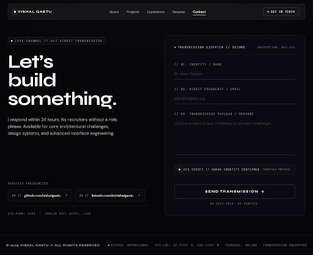

# contact_form\n\n\n\n## Prompt Used\n```\nCreate the desktop Contact page for Vishal Gastu's dark portfolio adhering strictly to the user specifications and {{DATA:DESIGN_SYSTEM:DESIGN_SYSTEM_1}}.

Key Design Directives:
- Theme: Pitch black/dark void aesthetic (#080808 / #000000 background). Minimal, premium, confident, respectful, not corporate. No clutter or background decoration; generous negative space does the work. Feeling like sending a transmission into deep space.
- Header: Use the TopNavBar consistent with the portfolio (Brand: "VISHAL GASTU", Navigation: About, Projects, Experience, Resume, Contact [active], Action: "Get in Touch" or indicator).
- Main Layout: A two-column split with ample breathing room, centered within a max-w-7xl container:
  - Left Half:
    - Large typographic block: "Let's\nbuild\nsomething." set in massive Syne Bold (font-display), uppercase or bold title case spanning 3 lines with tight line height.
    - Below: DM Sans (font-body) secondary text: "I respond within 24 hours. No recruiters without a role, please." in text-neutral-400 / text-white/70.
    - Below that: Two icon-link rows — GitHub and LinkedIn — ghost-style (subtle border, sleek hover transition, minimalist monochromatic arrow or icon, displaying handle/url or platform name, e.g. "github.com/vishalgastu", "linkedin.com/in/vishalgastu").
    - Optional telemetry pill or coordinate note in muted mono (e.g., "[SYS.CHANNEL // 04] DIRECT TRANSMISSION").
  - Right Half:
    - Contact form nested inside a dark glass panel (backdrop-blur-md, bg-white/[0.02] or bg-neutral-950/60, 1px subtle border border-white/10, 14px border radius / rounded-[14px], p-8 md:p-10):
      - Form Title/Status: Minimal header or status tag (e.g., "TRANSMISSION DISPATCH // SECURE").
      - Name field: bottom-line input style (border-0 border-b border-white/20 bg-transparent focus:border-white focus:ring-0 text-white font-body px-0 py-2.5 transition-colors), label in muted mono uppercase above ("// 01. IDENTITY / NAME").
      - Email field: bottom-line input style (border-0 border-b border-white/20 bg-transparent focus:border-white focus:ring-0 text-white font-body px-0 py-2.5 transition-colors), label in muted mono uppercase above ("// 02. DIRECT FREQUENCY / EMAIL").
      - Message field: 5-line textarea with bottom-line or clean subtle border style, label in muted mono uppercase above ("// 03. TRANSMISSION PAYLOAD / MESSAGE").
      - Turnstile/captcha placeholder: small muted area with a subtle shield/pulse dot icon and mono text ("Cloudflare Turnstile Verified" or "SYS.VERIFY // HUMAN IDENTITY CONFIRMED").
      - Submit button: full-width ghost outline button (border border-white/20 hover:border-white hover:bg-white hover:text-black text-white font-display uppercase tracking-widest text-sm py-4 rounded-lg transition-all duration-300 flex items-center justify-center gap-2) with label: "Send transmission →".
      - Very small muted text below button: "No data sold. No cookies." in text-xs text-white/40 tracking-wider font-mono text-center mt-3.
- Footer: Telemetry footer consistent with {{DATA:COMPONENTS:COMPONENTS_3}} docked at the bottom with copyright, operational status, terminal info.\n```\n