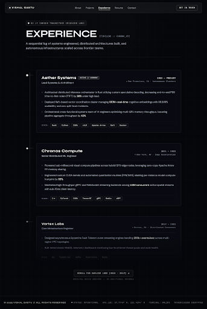

# experience_timeline\n\n\n\n## Prompt Used\n```\nDesign an ultra-refined, premium dark-mode Work Experience Timeline page for Vishal Gastu ("Digital Universe" portfolio).

Top Navigation:
Use existing TopNavBar component layout or matching header: "VISHAL GASTU", links: About, Projects, Experience (active state), Resume, Contact, trailing button "Get in Touch".

Header section:
- Small category telemetry badge / tracker: "03 // CAREER TRAJECTORY [MISSION LOG]" with a small live pulse dot.
- Page title: "EXPERIENCE" in prominent Syne (uppercase, bold, tracking-tight/display), accompanied by a muted monospace label tag "[TIMELINE :: CHRONO_V3]".
- Subtitle/descriptor: "A sequential log of systems engineered, distributed architectures built, and autonomous infrastructures scaled across frontier teams."

Vertical timeline layout:
- Left-aligned vertical axis: a crisp, thin vertical line in rgba(255,255,255,0.10) with subtle glow or gradient points.
- Along the line, each timeline milestone has an anchor indicator: a crisp glowing white dot / crosshair node connected via a horizontal connector line to the entry card.
- 3 distinct chronological entries:
  1. Top Entry (Most Recent):
     - Anchor dot has active status ping / subtle pulse ring ("ACTIVE // CURRENT").
     - Company: "Aether Systems" (Syne medium, text-white, text-xl or 2xl).
     - Date Range: "2023 — PRESENT" in JetBrains Mono muted (text-neutral-400, text-xs, tracking-widest).
     - Role Title: "Lead Systems & AI Architect" (DM Sans, text-neutral-300 font-medium text-sm tracking-wide mt-1).
     - Location / Scope badge: "San Francisco, CA · Autonomous Clusters" in muted mono.
     - Bullets (3-4 crisp DM Sans text items with technical precision):
       • Architected distributed inference orchestrator in Rust utilizing custom speculative decoding, decreasing end-to-end P99 time-to-first-token (TTFT) by 38% under high load.
       • Deployed Raft-based vector coordination cluster managing 100M+ real-time cognitive embeddings with 99.999% availability and zero split-brain incidents.
       • Orchestrated cross-functional systems team of 14 engineers optimizing multi-GPU memory throughput, boosting pipeline aggregate throughput by 42%.
     - Tech Tag chips: "Rust", "Python", "CUDA", "vLLM", "Apache Arrow", "Raft", "Docker" (in subtle dark glass chips, 1px border border-white/10, text-xs font-mono text-neutral-300).

  2. Second Entry:
     - Anchor dot: solid luminous node.
     - Company: "Chronos Compute" (Syne medium, text-white, text-xl).
     - Date Range: "2021 — 2023" in JetBrains Mono muted (text-xs, tracking-widest).
     - Role Title: "Senior Distributed ML Engineer" (DM Sans, text-neutral-300 text-sm).
     - Location / Scope badge: "New York, NY · Edge Acceleration".
     - Bullets:
       • Pioneered sub-millisecond visual compute pipelines across hybrid GPU edge nodes, leveraging zero-copy Apache Arrow FFI memory sharing.
       • Engineered custom CUDA kernels and automated quantization kernels (FP8/INT4), slashing per-instance model compute footprint by 55%.
       • Maintained high-throughput gRPC and WebSocket streaming backends serving 4.5M concurrent active spatial streams with sub-15ms client latency.
     - Tech Tag chips: "C++", "PyTorch", "CUDA", "TensorRT", "gRPC", "Redis", "eBPF".

  3. Third Entry (Partially faded at bottom):
     - Anchor dot: softer muted node.
     - Company: "Vortex Labs" (Syne medium, text-white/90, text-xl).
     - Date Range: "2019 — 2021" in JetBrains Mono muted.
     - Role Title: "Core Infrastructure Engineer" (DM Sans, text-neutral-400 text-sm).
     - Location / Scope badge: "Boston, MA · Distributed Consensus".
     - Bullets:
       • Designed asynchronous Byzantine Fault Tolerant event streaming engines handling 250k+ events/sec across multi-region VPC topologies.
       • Built deterministic WebGL telemetry dashboard monitoring low-level kernel thread pools and node health.
     - Tech Tag chips: "Go", "TypeScript", "Kafka", "Kubernetes", "WebGL".
     - Visual treatment for entry 3: Partially faded towards bottom with an elegant linear gradient mask (mask-image: linear-gradient(to bottom, black 40%, transparent 100%) or opacity gradient) with a sleek "SCROLL FOR EARLIER LOGS [2018 - 2019] ↓" indicator.

Cards styling:
- Dark glass aesthetic (`bg-[#0B0F17]/60` or `bg-white/[0.03]`, backdrop-blur-md, `border border-white/10`, `rounded-lg` / 8px radius, generous internal padding p-6 to p-8).
- Clean spacing, mission-log telemetry feel, typography strictly following Syne for headers, DM Sans for descriptions and bullets, JetBrains Mono for system metrics, dates, and badges.

Footer:
- Use standard footer telemetry matching {{DATA:DESIGN_SYSTEM:DESIGN_SYSTEM_1}} and {{DATA:COMPONENTS:COMPONENTS_3}}: "© 2025 VISHAL GASTU // ALL RIGHTS RESERVED", status telemetry ("STATUS: OPERATIONAL", "TERMINAL: ONLINE", "TRANSMISSION ENCRYPTED").\n```\n