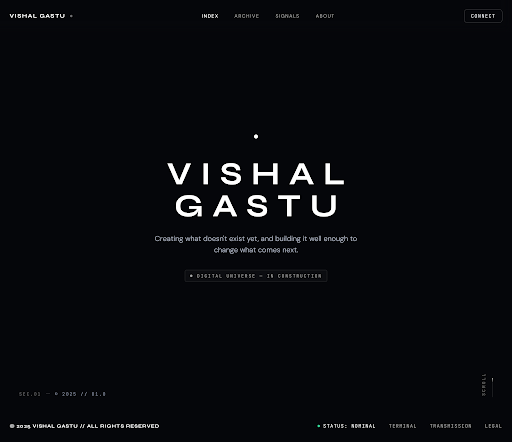

# hero\n\n\n\n## Prompt Used\n```\nFull viewport height cinematic portfolio hero screen for VISHAL GASTU.
Exact Layout & Details:
- Background: pure #05060A, nearly pitch black, solid, no colorful gradients, pristine negative space.
- Subtle, ultra-minimal TopNavBar: 'VISHAL GASTU' on the left in subtle uppercase tracking, navigation links ('Index', 'Archive', 'Signals', 'About') with low opacity, trailing 'Connect' button or coordinates.
- Main hero content: perfectly vertically centered in the viewport with deep breathing room.
- Center stack elements:
  1. Top-center: a tiny glowing white dot (10px circular element with soft diffused glow, box-shadow: 0 0 16px 2px rgba(255,255,255,0.7), ghost light feel).
  2. Directly below the dot: 'VISHAL GASTU' in large, wide-letter-spaced uppercase Syne Bold / editorial display font (clamp 2.5rem–4.5rem, letter-spacing tracking-[0.25em] or 0.3em, crisp stark white text, feeling like it emerged from darkness).
  3. Directly below the name: tagline in DM Sans, secondary text color (text-neutral-400 or rgba(255,255,255,0.65)), font weight 300/400, max-w-xl text-center leading-relaxed text-sm md:text-base: "Creating what doesn't exist yet, and building it well enough to change what comes next."
  4. Below tagline: muted monospaced status indicator badge or text in JetBrains Mono / monospace: "DIGITAL UNIVERSE — IN CONSTRUCTION" in very small font (text-[11px] or text-xs), high tracking/letter-spacing, muted opacity text-neutral-500.
- Bottom-right corner: subtle scroll indicator with a thin vertical hairline track (1px width, 48px height, rgba(255,255,255,0.15)) and a tiny white dot gliding downward smoothly with CSS animation, plus tiny vertical 'SCROLL' label or status.
- Bottom-left corner: subtle coordinate or year tag '© 2025 // 01.0' in monospace.
- Aesthetic: Film title opening frame, serene, luminous, restrained, high-fashion minimalism. Negative space is the design.\n```\n