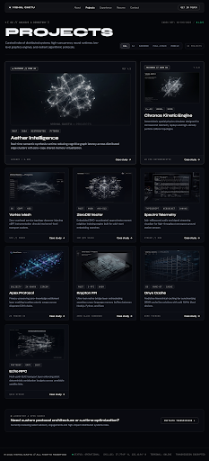

# projects_grid\n\n\n\n## Prompt Used\n```\nProjects index page. Dark mode (#06080F / #05060A deep obsidian background), premium editorial curated gallery aesthetic.

Top Navigation bar (standard component: VISHAL GASTU brand mark, links: About, Projects [ACTIVE], Experience, Resume, Contact, button: "Get in Touch").

Header Section:
- Top breadcrumb/metadata tag: [ 02 // ARCHIVE & DIRECTORY ]
- Big header area:
  - Page heading: "Projects" in massive prominent Syne / display typeface (bold uppercase or display tracking).
  - Beside / inline with heading (or immediately aligned alongside it in an editorial header bar): Filter chips row — "All" (active with faint ghost-white background, e.g. bg-white/10 text-white border-white/30), "AI", "Backend", "Full-Stack", "Mobile" — ghost outline chips, 8px radius, hover states.
  - Aligned to the top right / opposite side: Sort/count label: "12 projects" in muted mono (font-label / monospace uppercase, e.g. text-white/40).

Grid Section:
- Editorial 3-column grid (or curated masonry-style grid) of project cards.
- Each card:
  - Dark glass surface (#0B0D14 / rgba(11, 13, 20, 0.8)), 1px border (border-white/10), 8px border-radius (rounded-lg), subtle backdrop-blur.
  - Top: placeholder cover image area with dark glass slightly lighter (16:9 aspect ratio or rich technical holographic visual container with subtle abstract geometric linework, glowing telemetry wireframes, or constellation data coordinates).
  - Below cover: tag chips row (e.g. "RUST", "CUDA", "DISTRIBUTED", "WEBGL", "PYTORCH", "TYPESCRIPT") in subtle monospace badge pills.
  - Below tags: Project name in Syne medium / display font (e.g., "Aether Intelligence", "Chronos Kinetic Engine", "Vortex Mesh", "Hyperion Core", "Neural Weave", "Spectra Telemetry", "Apex Protocol", "ZeroDB Vector", "Synthetix OS", "Krypton FFI", "Onyx Cache", "Echo RPC").
  - Below name: crisp one-line description in secondary sans / DM Sans (e.g., "Real-time semantic synthesis runtime reducing cognitive graph latency across distributed edge clusters.").
  - Bottom: "Case study →" link with a sleek micro-arrow, hover transition.
- Featured projects (e.g. Aether Intelligence & Chronos Kinetic Engine):
  - Prominent featured styling: distinct faint glowing border (e.g. shadow-[0_0_25px_rgba(255,255,255,0.06)], border-white/25, slightly taller/expanded layout, or badge "FEATURED // CORE 01").

Footer Section:
- Website telemetry footer (standard component: copyright, status operational, coordinates, terminal online, encrypted transmission).

Tone: Curated gallery, refined, serene, luminous, dark luxury sci-fi minimalism.\n```\n