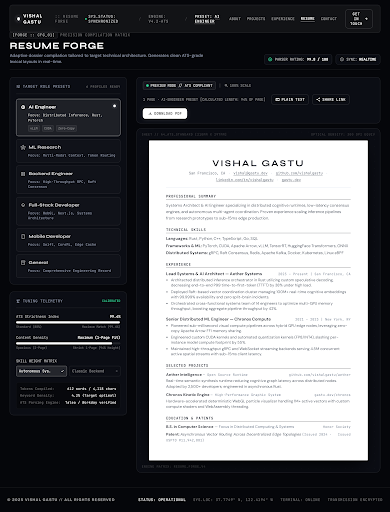

# resume_forge\n\n\n\n## Prompt Used\n```\nBuild "Resume Forge" — a holographic, precision engineering resume customization console interface matching the Vishal Gastu digital universe aesthetic.

Layout & Canvas:
- Full desktop application view (~100vh viewport style or scrollable workbench, cinematic dark theme `#050507` / pitch black `#000000`).
- Unified top navigation bar matching the design system with logo "VISHAL GASTU // RESUME FORGE", HUD status telemetry ("SYS.STATUS: SYNCHRONIZED", "ENGINE: v4.2-ATS", "PRESET: ACTIVE"), and subtle border separation.

Workspace Split (Two-column layout):
1. Left Panel (approx 30% width, ~360px - 400px):
   - Header with badge `[FORGE :: CFG_01]` and Title: "RESUME FORGE" in JetBrains Mono / monospace uppercase font, tracked wide.
   - Subtitle: "Adaptive dossier compilation tailored to target technical architecture."
   - Role Preset Selector:
     Vertical stack of interactive role cards:
     1. "AI Engineer" (ACTIVE / SELECTED state: subtle ghost-white border glow `border-white/40 ring-1 ring-white/20 bg-white/[0.07]`, glowing dot/indicator, icon representing neural/weights matrix, sublabel "Focus: Distributed Inference, Rust, PyTorch").
     2. "ML Research" (Dark glass `bg-white/[0.02] border-white/10 hover:border-white/20`, icon representing tensor topology, sublabel "Focus: Multi-Modal Context, Token Routing").
     3. "Backend Engineer" (Dark glass, icon representing low-latency distributed networks, sublabel "Focus: High-Throughput RPC, Raft Consensus").
     4. "Full-Stack Developer" (Dark glass, icon representing client-runtime interfaces, sublabel "Focus: WebGL, Next.js, Systems Architecture").
     5. "Mobile Developer" (Dark glass, icon representing embedded client runtime, sublabel "Focus: Swift, CoreML, Edge Cache").
     6. "General" (Dark glass, icon representing core systems index, sublabel "Focus: Comprehensive Engineering Record").
   - Tuning Telemetry Controls below cards:
     - Sliders / toggles for "ATS Optimization Strictness: 99.4%", "Density: Maximum (1-Page Fit)", "Skill Weight Matrix: Autonomous Systems".

2. Right Panel (approx 70% width):
   - Dark HUD container workbench with subtle dot grid/blueprint background `#0B0D14`.
   - Top Toolbar of Right Panel:
     - Left side: Status badge "PREVIEW MODE // ATS COMPLIANT" and breadcrumb or zoom indicator (100%).
     - Right side: Muted monospace telemetry label: "1 PAGE · AI-ENGINEER PRESET [CALCULATED LENGTH: 94% OF PAGE]".
     - Top-right action group with ghost-outline buttons:
       - "Download PDF" (with subtle download/arrow icon, crisp border, ghost hover effect)
       - "Plain Text" (terminal code icon)
       - "Share Link" (link / share node icon)
   - Live Resume Preview Canvas:
     - High-contrast, realistic, hyper-clean ATS-friendly single-column PDF document preview centered in the workbench with soft subtle elevation/shadow on the dark workbench background.
     - Document surface: Crisp off-white/paper texture `#FFFFFF` or `#FBFBFC` with sharp charcoal/black typography `#0F172A` / `#111827`, engineered typography hierarchy (clean serif or sans header, crisp mono metadata headers):
       - Header: "VISHAL GASTU" (Bold uppercase), contact row below (`San Francisco, CA · vishal@gastu.dev · github.com/vishalgastu · linkedin.com/in/vishalgastu · gastu.dev`).
       - Summary: "Systems Architect & AI Engineer specializing in distributed cognitive runtimes, low-latency consensus engines, and autonomous multi-agent coordination. Proven experience scaling inference pipelines from research prototypes to sub-15ms edge production."
       - Section: "TECHNICAL SKILLS"
         - Categorized: Languages (Rust, Python, C++, TypeScript), Frameworks & ML (PyTorch, CUDA, Arrow, vLLM, HuggingFace), Distributed Systems (gRPC, Raft, Redis, Apache Kafka, Docker, Kubernetes).
       - Section: "EXPERIENCE"
         - "Lead Systems & AI Architect — Aether Systems" (2023 – Present | San Francisco, CA)
           - Bullet points emphasizing measurable latency reductions, 42% throughput improvements, Raft consensus orchestration.
         - "Senior Distributed ML Engineer — Chronos Compute" (2021 – 2023 | New York, NY)
           - Bullets on sub-millisecond visual compute pipelines, volumetric logic, zero-copy Apache Arrow FFI memory sharing.
       - Section: "SELECTED PROJECTS"
         - "Aether Intelligence" — Real-time semantic synthesis runtime reducing cognitive graph latency across distributed nodes.
         - "Chronos Kinetic Engine" — Hardware-accelerated deterministic WebGL particle visualizer handling 1M+ active vectors.
       - Section: "EDUCATION & PATENTS"
         - "B.S. in Computer Science — Focus in Distributed Computing"
         - "Patent: Asynchronous Vector Routing Across Decentralized Edge Topologies (Issued 2024)".

Atmosphere & Styling:
- Strictly adhere to {{DATA:DESIGN_SYSTEM:DESIGN_SYSTEM_1}} dark cinematic palette: true black `#000000`, slate black `#08090C`, luminous white `#FFFFFF`, subtle white borders (`border-white/10`, `border-white/20`).
- JetBrains Mono / monospace headers, uppercase micro-labels, HUD-style telemetry markers, and ultra-refined glass aesthetic.
- Feeling like configuring a mission briefing: precise, functional, impressive, and instantly usable.\n```\n