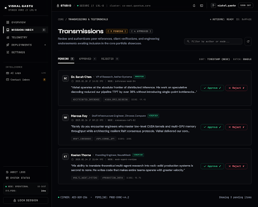

# studio_dashboard\n\n\n\n## Prompt Used\n```\nPrivate owner-only studio/admin dashboard in dark mode, strictly following the Vishal Gastu design system: deep jet black backgrounds (#080808 / #0B0D11), crisp monospace telemetry labels (JetBrains Mono), refined headlines (Syne), 1px subtle white/neutral borders (border-white/10), and 8px rounded corners.

Header & Structure:
- Top Navigation: Minimal docked header. Brand mark reads 'STUDIO' in uppercase JetBrains Mono alongside a small padlock icon indicator and session state 'SECURE // LVL-0'. On the right: owner profile badge featuring 'Vishal Gastu', small GitHub/identity avatar, status dot, and a ghost 'Sign out' button.
- Left Sidebar (200px / compact docked): Clean, technical vertical navigation.
  Items with small minimal icons:
  1. Overview
  2. Testimonials (Active state: accented border-l-2 or subtle glow pill, text-white)
  3. Contact Inbox (with a tiny badge '2')
  4. AI Logs
  Footer of sidebar: System integrity 'NODE: OPERATIONAL' and latency 'SYS.PING: 14ms'.

Main Content Area (Mission Control Inbox / Testimonials Management):
- Header Row:
  - Page title 'Transmissions' in Syne font, bold and precise.
  - Beside it: muted mono chips '[ 3 PENDING ]' in amber/emerald and '[ 4 APPROVED ]' in muted mono slate.
  - Filter / View controls or Quick search input ('Filter by author or node...').
- Tab Bar:
  - 'Pending (3)' [Active tab, border-b-2 or solid pill]
  - 'Approved (4)'
  - 'Rejected (0)'
- Pending Submissions List (clean, compact stack of dark glass cards with 8px radius and 1px border-white/10, bg-white/[0.02] hovering to bg-white/[0.04]):
  Card 1:
  - Author: Monogram badge 'SC' + 'Dr. Sarah Chen' + 'VP of Research, Aether Systems'
  - Submitted timestamp in muted mono: '2025.02.18 // 14:32 UTC'
  - Preview message text (2 lines clipped): 'Vishal operates at the absolute frontier of distributed inference. His work on speculative decoding reduced our pipeline TTFT by over 38% without introducing single-point bottlenecks...'
  - Right-aligned actions: 'Approve ✓' (ghost emerald border, text-emerald-400 hover:bg-emerald-500/10) and 'Reject ✗' (ghost rose border, text-rose-400 hover:bg-rose-500/10).
  
  Card 2:
  - Author: Monogram badge 'MR' + 'Marcus Ray' + 'Staff Infrastructure Engineer, Chronos Compute'
  - Submitted timestamp: '2025.02.16 // 09:15 UTC'
  - Preview message text: 'Rarely do you encounter engineers who master low-level CUDA kernels and multi-GPU memory throughput while architecting resilient Raft consensus protocols. Vishal delivered our core runtime two weeks ahead of schedule.'
  - Right-aligned actions: 'Approve ✓' and 'Reject ✗'.

  Card 3:
  - Author: Monogram badge 'KT' + 'Kaelen Thorne' + 'Founding Engineer, NeuralMesh'
  - Submitted timestamp: '2025.02.14 // 21:04 UTC'
  - Preview message text: 'His ability to translate theoretical multi-agent research into rock-solid production systems is second to none. He writes code that makes entire teams operate with greater velocity.'
  - Right-aligned actions: 'Approve ✓' and 'Reject ✗'.

Aesthetics & Feel:
- Pure mission control dashboard: ultra-efficient spacing, zero superfluous ornamentation, crisp contrast, glowing indicators, exact typography hierarchy.\n```\n