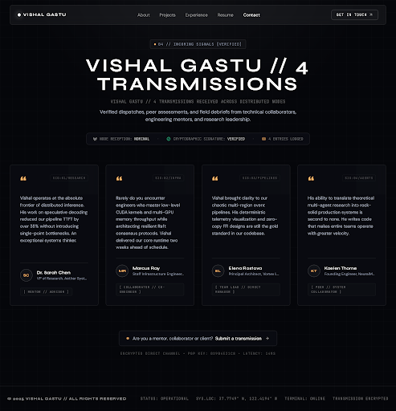

# transmissions\n\n\n\n## Prompt Used\n```\nCreate a cinematic, premium dark-mode portfolio testimonials section screen titled 'Transmissions' for Vishal Gastu.

Use the TopNavBar and Footer components consistent with {{DATA:SCREEN:SCREEN_2}} and {{DATA:SCREEN:SCREEN_6}} and design system {{DATA:DESIGN_SYSTEM:DESIGN_SYSTEM_1}}.

Key Design Specifications:
1. Header / Intro Block:
   - Section sub-badge/label: '04 // INCOMING SIGNALS [VERIFIED]' or 'TRANSMISSIONS RECEIVED' in JetBrains Mono / font-label, uppercase tracking-widest, muted text.
   - Main headline: 'VISHAL GASTU // 4 TRANSMISSIONS' or 'TRANSMISSIONS' in bold uppercase Syne / font-display with subtitle 'Vishal Gastu // 4 transmissions received across distributed nodes'.
   - Supporting narrative: 'Verified dispatches, peer assessments, and field debriefs from technical collaborators, engineering mentors, and research leadership.'

2. Telemetry / Metadata Bar:
   - A subtle status banner: 'NODE RECEPTION: NOMINAL' • 'CRYPTOGRAPHIC SIGNATURE: VERIFIED' • '4 ENTRIES LOGGED' in crisp font-mono text-xs text-white/40 border border-white/10 rounded px-4 py-2 inline-flex items-center gap-6.

3. 3-Column Card Grid (Testimonials / Transmissions):
   - 3 columns (or 3 primary cards + 1 featured wide transmission, or clean 3-4 card layout). Let's feature 4 distinct transmissions:
     Card 1:
     - Opening quote mark: Large elegant quotation mark in Syne font, ember color (#FFB86B), light and luminous.
     - Body text (DM Sans / font-body, secondary text color, high legibility, 4-5 lines): 'Vishal operates at the absolute frontier of distributed inference. His work on speculative decoding reduced our pipeline TTFT by over 38% without introducing single-point bottlenecks. An exceptional systems thinker.'
     - Divider: 1px border-t border-white/10
     - Author Row: Dark glass circular avatar with initials 'SC' in glowing subtle ember/white, Name 'Dr. Sarah Chen' in Syne medium font-semibold text-white, Role 'VP of Research, Aether Systems' in DM Sans muted text-xs/sm.
     - Tag at bottom: Tiny muted mono tag '[ MENTOR // ADVISOR ]' in JetBrains Mono / font-label text-[10px] tracking-widest text-white/40.

     Card 2:
     - Large ember quotation mark (#FFB86B).
     - Body text: 'Rarely do you encounter engineers who master low-level CUDA kernels and multi-GPU memory throughput while architecting resilient Raft consensus protocols. Vishal delivered our core runtime two weeks ahead of schedule.'
     - Divider: 1px border-t border-white/10
     - Author Row: Dark glass avatar initials 'MR', Name 'Marcus Ray', Role 'Staff Infrastructure Engineer, Chronos Compute'.
     - Tag at bottom: '[ COLLABORATOR // CO-ENGINEER ]'

     Card 3:
     - Large ember quotation mark (#FFB86B).
     - Body text: 'Vishal brought clarity to our chaotic multi-region event pipelines. His deterministic telemetry visualization and zero-copy FFI designs are still the gold standard in our codebase.'
     - Divider: 1px border-t border-white/10
     - Author Row: Dark glass avatar initials 'EL', Name 'Elena Rostova', Role 'Principal Architect, Vortex Labs'.
     - Tag at bottom: '[ TEAM LEAD // DIRECT MANAGER ]'

     Card 4 (or 4th transmission balanced nicely in the grid or telemetry row):
     - Large ember quotation mark (#FFB86B).
     - Body text: 'His ability to translate theoretical multi-agent research into rock-solid production systems is second to none. He writes code that makes entire teams operate with greater velocity.'
     - Divider: 1px border-t border-white/10
     - Author Row: Dark glass avatar initials 'KT', Name 'Kaelen Thorne', Role 'Founding Engineer, NeuralMesh'.
     - Tag at bottom: '[ PEER // SYSTEM COLLABORATOR ]'

   - Card Styling: Dark glass (bg-neutral-900/60 or bg-white/[0.03] backdrop-blur-md), 1px border border-white/10 hover:border-white/20 transition-all duration-300, 8px radius (rounded-lg), generous padding (p-8), subtle elevation and grid ambient glow.

4. Bottom Centered CTA:
   - Subtle centered ghost-link style CTA:
     'Are you a mentor, collaborator or client? → Submit a transmission' with subtle hover arrow micro-interaction, delicate glowing underline or glass capsule wrapper.
   - Secondary telemetry footnote matching the aesthetic of {{DATA:SCREEN:SCREEN_2}} and {{DATA:SCREEN:SCREEN_6}}.

5. Background & Atmospheric Polish:
   - Subtle dark background (#0a0a0c or #050507) with faint gridlines, radial gradients, dark space telemetry feel matching the existing portfolio screens.\n```\n